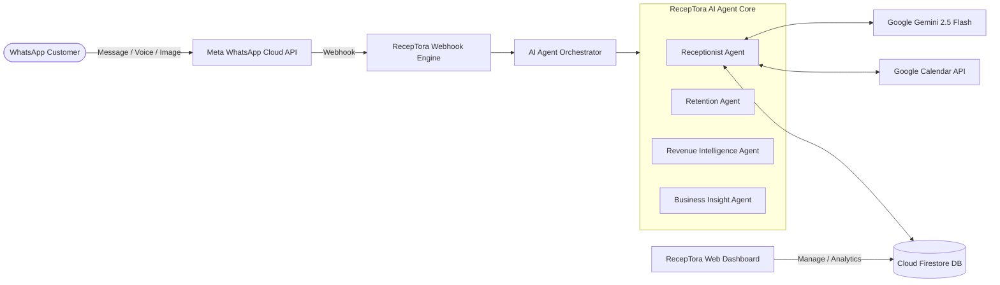

# RecepTora 💈✨

> **Proprietary Autonomous AI WhatsApp Receptionist & Business Intelligence Suite**

RecepTora is a proprietary enterprise-grade AI automation suite built for modern salons, spas, and service businesses. It acts as a 24/7 autonomous receptionist over WhatsApp Cloud API, seamlessly booking appointments into Google Calendar, managing schedule changes, winning back churned clients, and alerting owners to revenue gaps in their calendar.

---

## 🌟 Core System Architecture



---

## ⚡ Autonomous Agents

1. **Reception Agent (`reception.agent.js`)**:
   - Handles multi-turn natural customer conversations in English, Hinglish, and Hindi.
   - Real-time slot availability checking via Google Calendar API.
   - Multi-step appointment creation, rescheduling, and cancellations.
   - Tagged phone number indexing for friction-free booking lookups.
   - Audio/Voice note and reference image handling.

2. **Retention Agent (`retention.agent.js`)**:
   - Identifies inactive/churn-risk customers (25–90 days since last visit).
   - Composes warm, personalized win-back messages without generic spam discounts.
   - Automated scheduled dispatch via WhatsApp Cloud API.

3. **Revenue Intelligence Agent (`revenue.agent.js`)**:
   - Scans calendar booking density to detect recurring dead zones and underbooked slots.
   - Generates actionable, revenue-optimizing recommendations directly to the salon owner.

4. **Business Insight Agent (`insight.agent.js`)**:
   - Aggregates monthly bookings, busiest business hours, and at-risk clientele.
   - Synthesizes clear, executive summaries for salon owners.

---

## 📁 Repository Structure

```
receptora/
├── backend/                  # Express REST API, AI Agents, Meta Webhooks, Calendar Adapters
│   ├── src/
│   │   ├── agents/          # Autonomous AI agents (Reception, Retention, Revenue, Insight)
│   │   ├── config/          # Firebase & Google Calendar authentication
│   │   ├── middleware/      # Tenant resolver & security middleware
│   │   ├── routes/          # REST endpoints for bookings, customers, settings
│   │   ├── scheduler/       # Cron jobs for automated retention and revenue alerts
│   │   ├── services/        # Calendar, Firestore, LLM, and WhatsApp services
│   │   └── webhooks/        # WhatsApp Cloud API & Instagram webhook handlers
│   ├── package.json
│   └── .env.example
├── frontend/                 # React 19 + Vite + Tailwind CSS Owner Dashboard
│   ├── src/
│   │   ├── components/      # UI components (Calendar, Bookings, BusinessSetup)
│   │   ├── pages/           # Dashboard, Conversations, Customers, Settings
│   │   └── firebase.js      # Client-side Firebase configuration
│   ├── package.json
│   └── .env.example
├── scripts/                  # Onboarding scripts and migration utilities
└── COPYRIGHT.md              # Proprietary Authorship and Ownership Declaration
```

---

## 🔒 Proprietary Notice & Commercial Ownership

**All Rights Reserved.**  
Copyright (c) 2026 **Kashyap Makwana**.

This software, its system architectures, agent workflows, routing algorithms, and source code are strictly proprietary and confidential. Unauthorized copying, distribution, modification, public display, reverse engineering, or commercial use without prior written authorization from Kashyap Makwana is strictly prohibited. Detailed legal authorship declaration is registered in [COPYRIGHT.md](COPYRIGHT.md).
